# Segmentasi instance pada lingkungan indoor nyata

**Visi Komputer EA234503 · Evaluasi CPMK 3 · NRP berakhiran 8**

Perbandingan YOLOv8n-seg, YOLO11n-seg, dan Mask R-CNN pada Panoptic Indoor Segmentation v5 dan foto ponsel. Institut Teknologi Sepuluh Nopember, November 2026.

## Ringkasan

Eksperimen NRP 8 menguji apa yang terjadi ketika pelatihan dibatasi pada tiga kelas tersulit. Tiga pilot pada split validasi memilih `knife`, `light`, dan `spoon`. Setiap arsitektur kemudian dilatih dua kali pada set gambar yang sama, sekali dengan seluruh kelas dan sekali dengan tiga kelas tersebut. Evaluasi memakai 359 foto test resmi dan 40 foto indoor dari ponsel.

Pada test resmi, model yang dilatih dengan semua kelas unggul pada ketiga pasangan saat penilaian dibatasi ke kelas target. Mask R-CNN mencatat AP target 1,15% dengan seluruh kelas dan 0,56% dengan tiga kelas. Pada foto ponsel, pasangan Mask R-CNN justru berubah dari 0,16% menjadi 0,51%. Set foto ponsel hanya berisi satu mask pisau dan dua mask sendok, sehingga hasil tiga kelas peka terhadap beberapa instance saja.

Pada eksperimen lanjutan, Mask R-CNN v2 dengan transfer prediktor COCO dan input internal 800 px mencapai Mask AP 7,74% pada test resmi. Kontrol 640 px dengan seed yang sama mencapai 7,01%. Pada 37 kelas yang ada di kedua set uji, AP foto ponsel berubah dari 7,23% menjadi 7,44%. Uji pencahayaan pada empat foto redup memperlihatkan hasil yang berbeda antara orang dan lampu. [Metrik dan sumber data eksperimen](bukti/hasil/ringkasan.json)

### Panduan membaca visualisasi

Grafik hasil utama diikuti kurva training, perbandingan AP menurut kelas dan ukuran, serta contoh efek threshold pada satu citra. Lampiran A memperlihatkan empat adegan dari test resmi. Lampiran B pada PDF lokal memuat indeks dan lembar hasil untuk setiap foto HP.

### Pertanyaan penelitian

1. Bagaimana urutan performa model one-stage dan two-stage pada dua set uji?
2. Apakah pelatihan tiga kelas meningkatkan AP pada kelas target yang sama?
3. Pada prediksi yang gagal, seberapa sering overlap cukup tetapi labelnya salah?
4. Apa yang berubah setelah inisialisasi prediktor dan ukuran input Mask R-CNN v2 diubah?

<!-- page-break -->

## Data, anotasi, dan evaluasi

| Split | Foto | Mask | Kelas dengan mask | Pemakaian |
|---|---:|---:|---:|---|
| Latih v5 | 397 | 4.479 | 65 | Optimasi bobot |
| Validasi v5 | 166 | 2.022 | 58 | Pemilihan kelas dan konfigurasi |
| Test resmi v5 | 359 | 5.344 | 69 | Evaluasi publik |
| Test foto ponsel v3 | 40 | 619 | 39 | Evaluasi eksternal |

Taksonomi publik memuat 74 kelas aktif jika ketiga split digabung. Sembilan kelas yang beranotasi pada test resmi tidak memiliki contoh positif di split latih. Model penuh tetap memakai taksonomi 74 kelas. Perbandingan antar-domain memakai 37 kelas dengan mask acuan pada kedua set, sehingga perubahan AP mengacu pada himpunan kelas yang sama. [Rincian kelas dan pembagian v5](https://universe.roboflow.com/panopticindoor/panoptic-indoor-segmentation/dataset/5) · [Perbandingan antar-domain](bukti/hasil/domain-shift.csv)

Foto pribadi berasal dari 41 foto ponsel dengan EXIF dan waktu pengambilan asli. Hash 41 berkas cocok dengan metadata lokal. Tanggal pengambilan berkisar 16 Maret hingga 12 November 2026. Satu foto selasar yang menghadap area terbuka dikeluarkan. Dua belas dari 40 foto indoor ditetapkan sebagai sulit dari pemeriksaan visual sebelum analisis prediksi, mencakup cahaya redup, backlight, oklusi, dan sudut ekstrem. Foto ponsel dipakai untuk evaluasi eksternal. [Daftar kondisi dan audit anotasi](TEST_PRIBADI.md)

Mask foto ponsel berasal dari ekspor COCO Roboflow dan memakai nama kelas dataset publik. Audit v3 menemukan mask pada semua 41 foto job. Setelah filter cakupan indoor, evaluator memakai 619 mask. Peninjauan visual menemukan sebagian instance berdekatan masih digabung atau terlewat. Tiga foto diperbaiki di Roboflow setelah v3 dibekukan. Hasil yang dilaporkan tetap memakai snapshot v3 yang sama untuk semua model. [Catatan revisi](LOGBOOK.md) · [Deklarasi alat bantu anotasi](DEKLARASI_AI.md)

### Praproses dan metrik

Rasio aspek citra dipertahankan dalam kanvas 640 × 640 dengan padding 114. Mask, kotak batas, dan luas diproyeksikan ke grid itu. Empat citra publik perlu dirotasi agar orientasi piksel cocok dengan koordinat COCO. Overlay setelah rotasi dibandingkan dengan versi asli sebelum perubahan dikunci. Pemeriksaan hash piksel pada grid 640 tidak menemukan JPEG identik antar-split publik atau antara foto ponsel dan split publik. [Kode penyiapan data](prepare_dataset.py) · [Bukti empat koreksi orientasi](bukti/arah-empat-citra-v5.jpg)

COCO menghitung Mask AP50-95 dari kurva precision-recall pada sepuluh ambang IoU, dari 0,50 sampai 0,95. AP50 dan AP75 memakai ambang tunggal. Kelas beranotasi tanpa prediksi yang memenuhi kriteria mendapat AP 0. Kelas tanpa mask acuan pada split dikeluarkan dari rata-rata. Evaluasi memakai confidence minimum 0,005 dan paling banyak 100 deteksi per gambar. Evaluasi foto ponsel dijalankan di CPU. [Implementasi evaluator](metrics.py) · [Kode COCOeval](https://github.com/cocodataset/cocoapi/blob/master/PythonAPI/pycocotools/cocoeval.py)

<!-- page-break -->

## Hipotesis dan rancangan NRP 8

Hipotesis dicatat di logbook pada 24 November 2026 pukul 02.36.32 WIB. Training paling awal pada artefak pilot YOLOv8n dimulai pukul 02.56.43 WIB. Commit awal menyimpan hipotesis tersebut sebelum training. [Logbook](LOGBOOK.md) · [Waktu mulai dan log asli](bukti/hasil/waktu-gpu.csv)

| Hipotesis awal | Ukuran yang diperiksa |
|---|---|
| Mask R-CNN unggul pada batas kursi berdekatan karena ROIAlign dan mask per proposal. | AP75 `chair` pada test publik, disertai contoh oklusi. |
| YOLO11n unggul dari YOLOv8n pada `person` dan `bottle` dengan cahaya cukup. | AP setiap kelas. Peringkat pada test publik mencampur semua kondisi cahaya. |
| Pelatihan tiga kelas menaikkan AP target karena ruang klasifikasi lebih kecil. | AP rata-rata `knife`, `light`, dan `spoon` pada pasangan model yang sama. |

### Keluarga model

YOLOv8n-seg dan YOLO11n-seg menjalankan deteksi dan segmentasi satu tahap. Mask dihasilkan dari kombinasi koefisien tiap instance dengan peta prototipe bersama, lalu dipotong berdasarkan kotak deteksi. Mask R-CNN mengusulkan region lebih dulu, menggunakan ROIAlign, lalu memprediksi kategori, kotak, dan mask untuk proposal yang lolos. Head mask standarnya memprediksi grid 28 × 28 per region. [Implementasi mask Ultralytics 8.3.230](https://github.com/ultralytics/ultralytics/blob/v8.3.230/ultralytics/utils/ops.py) · [He dkk., Mask R-CNN](https://arxiv.org/abs/1703.06870)

### Pemilihan kelas dan kontrol eksperimen

Tiga pilot memakai tiga epoch dan split validasi. Kelas harus muncul di minimal lima gambar latih dan tiga gambar validasi. Peringkat memakai rata-rata Mask AP validasi terendah di ketiga pilot. Untuk skor sama, urutannya ditentukan oleh luas mask median yang lebih kecil, lalu jumlah gambar latih yang lebih sedikit. Ketiga target terpilih memperoleh AP pilot 0%. Ada 43 dari 397 gambar latih yang memiliki sedikitnya satu objek target. [Hasil seleksi kelas](hard-classes.json) · [Peringkat lengkap](peringkat-kesulitan.csv)

Enam run utama memakai seed 42, 16 epoch, Tesla T4, checkpoint epoch terakhir, dan grid 640 px. YOLO menggunakan AdamW, batch 8, dan flip horizontal dengan peluang 0,5. Mask R-CNN menggunakan AdamW dan batch 2. Kondisi tiga kelas mempertahankan gambar latih dan menyaring anotasinya. Perubahan ini sekaligus memperkecil ruang label dan mengurangi jumlah supervisi positif. [Konfigurasi training](train.py) · [Log per epoch](bukti/log-training/inti)

<!-- page-break -->

## Hasil eksperimen NRP 8

Setiap pasangan dinilai pada tiga kelas target yang sama. Kolom AP seluruh kelas melaporkan performa model penuh pada 69 kelas yang memiliki mask di test publik. Semua nilai dalam persen.

| Model | AP publik seluruh kelas | Publik, model penuh | Publik, model 3 kelas | Foto HP, model penuh | Foto HP, model 3 kelas |
|---|---:|---:|---:|---:|---:|
| YOLOv8n-seg | 2,26 | 0,30 | 0,00 | 0,64 | 0,00 |
| YOLO11n-seg | 1,71 | 0,17 | 0,00 | 0,09 | 0,00 |
| Mask R-CNN | 4,51 | 1,15 | 0,56 | 0,16 | 0,51 |

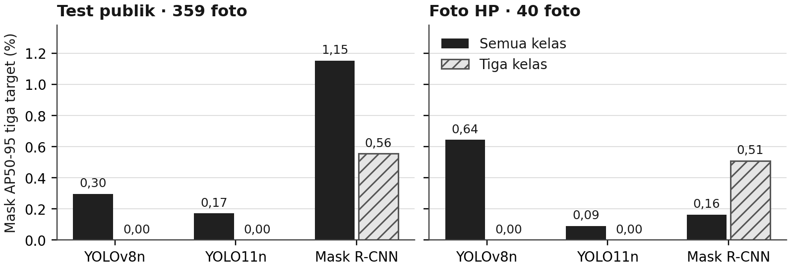

Pada test resmi, penyaringan kelas menurunkan AP target pada semua model. Kedua YOLO tiga kelas tidak menghasilkan prediksi mask di atas confidence 0,005. Pada foto HP, Mask R-CNN tiga kelas memiliki AP target lebih tinggi. Jumlah contoh di sana timpang. Test publik memiliki 19 mask pisau, 295 lampu, dan 36 sendok. Foto HP memiliki 1 pisau, 105 lampu, dan 2 sendok. [Enam hasil utama](bukti/hasil/nrp8-dua-test.csv) · [Audit dukungan kelas](TEST_PRIBADI.md)

Untuk kursi publik, AP75 Mask R-CNN mencapai 6,58%, dibanding 6,03% pada YOLOv8n dan 4,61% pada YOLO11n. Peringkat itu mendukung bagian hipotesis tentang AP75 kursi. Test publik belum menandai kursi yang tertutup, sehingga efek oklusi tidak dapat dihitung tersendiri. YOLO11n memperoleh AP botol 5,20% dan AP orang 4,31%. Pada YOLOv8n angkanya 5,19% dan 6,82%. Data memberi dukungan yang berbeda untuk kedua kelas. [Skor dan jumlah mask per kelas](bukti/hasil/ap-per-kelas.csv)

<!-- page-break -->

## Performa pada dua domain

| Model dengan pelatihan penuh | Test publik | Foto HP | Selisih HP terhadap publik |
|---|---:|---:|---:|
| YOLOv8n-seg | 2,57% | 2,51% | -0,06 poin |
| YOLO11n-seg | 2,07% | 0,98% | -1,08 poin |
| Mask R-CNN | 4,76% | 4,15% | -0,61 poin |
| Mask R-CNN v2, kontrol 640 | 7,15% | 7,23% | +0,08 poin |
| Mask R-CNN v2, COCO 800 | 8,04% | 7,44% | -0,60 poin |

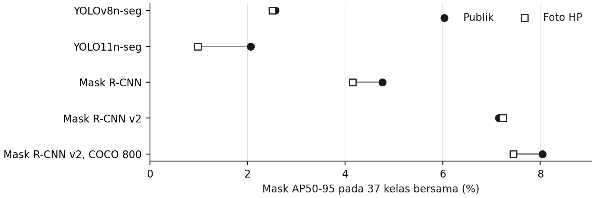

YOLO11n mencatat penurunan terbesar di antara tiga baseline. Selisih kecil pada YOLOv8n dan Mask R-CNN v2 kontrol masih bersifat deskriptif. Tiap set memiliki komposisi objek dan jumlah foto yang berbeda. Pencahayaan, sudut kamera, oklusi, dan kelengkapan mask pribadi juga dapat mengubah hasil. [Tabel perbandingan dengan angka sebelum pembulatan](bukti/hasil/domain-shift.csv)

### Foto kondisi sulit

Dua belas foto sulit dan 28 foto lain memiliki 23 kelas bersama. Pada 23 kelas itu, AP Mask R-CNN baseline adalah 3,81% dan 4,90%. YOLOv8n mencatat 1,66% dan 2,24%. YOLO11n mencatat 2,66% dan 1,30%. Pola YOLO11n menunjukkan bahwa perbedaan antar-kelompok tidak cukup untuk mengisolasi efek pencahayaan atau oklusi. Setiap kelompok membawa komposisi adegan dan objeknya sendiri. [Daftar dan kriteria foto sulit](TEST_PRIBADI.md)

<!-- page-break -->

## Replikasi Mask R-CNN dan uji praproses

### Replikasi dengan anggaran yang sama

Dua varian Mask R-CNN dilatih pada seed 42, 97, dan 123. Setiap run memakai 20 epoch, batch 2, AdamW, Tesla T4, dan split validasi yang sama. Perbedaan v1 dan v2 mencakup arsitektur serta resep bobot COCO awal. Nilai simpangan baku merangkum variasi tiga seed pada satu split.

| Varian | Seed 42 | Seed 97 | Seed 123 | Rata-rata dan SD | Menit rata-rata |
|---|---:|---:|---:|---:|---:|
| R50-FPN v1 | 11,76% | 12,67% | 11,65% | 12,03% ± 0,56 poin | 19,32 |
| R50-FPN v2 | 15,39% | 14,45% | 14,12% | 14,65% ± 0,66 poin | 22,37 |

V2 unggul pada ketiga pasangan dengan selisih rata-rata 2,62 poin. Seed 97 dipilih karena AP validasinya berada di tengah tiga replikasi v2. Pada test publik, checkpoint itu mencapai AP 7,01%, dibanding 4,51% pada Mask R-CNN baseline. Perbandingan test ini memakai 20 epoch untuk v2 dan 16 epoch untuk baseline. Perbandingan dengan durasi pelatihan yang sama tersedia pada validasi. Run v1 seed 42 selesai training, lalu unduhan terputus. Ringkasan dan CSV epoch dipulihkan dengan pemeriksaan CRC. [Protokol replikasi](PROTOKOL_RISET.md) · [Log asli](bukti/log-training/replikasi) · [Dokumentasi Torchvision v2](https://docs.pytorch.org/vision/stable/models/generated/torchvision.models.detection.maskrcnn_resnet50_fpn_v2.html)

### Uji praproses pada YOLOv8n

Enam run tambahan memakai 32 epoch, seed 42, dan 640 contoh per epoch. Eksperimen memeriksa pengulangan contoh langka, raster mask, serta augmentasi HSV. Dengan repeat factor, perubahan mask ratio dari 4 ke 2 menaikkan AP validasi dari 8,32% ke 9,98%. Di test resmi, kondisi terpilih mencatat AP semua kelas 2,15%, sedangkan kontrol seragam 32 epoch memperoleh 2,22%. AP target pada masing-masing kondisi adalah 0,51% dan 0,35%. [Metode sampling dan sumbernya](METODE_LANJUTAN.md) · [Catatan hasil](LOGBOOK.md)

<!-- page-break -->

## Inisialisasi prediktor COCO dan ukuran input

Mask R-CNN v2 diuji pada empat kombinasi inisialisasi prediktor dan ukuran input internal. Semua kondisi memakai backbone pralatih. Mode transfer mempertahankan baris bobot kelas, kotak, dan mask COCO untuk 33 nama kelas yang cocok persis, serta bobot upsampling mask bersama. Kondisi acak menginisialisasi ulang prediktor tersebut. Seluruh penilaian memakai grid 640 px. Mode 800 px memperbesar input yang sudah dipraproses ke 640 px. [Protokol dan aturan pemilihan](PROTOKOL_PERBAIKAN.md)

| Prediktor dan ukuran | Seed 42 | Seed 97 | Rata-rata AP | AP objek kecil |
|---|---:|---:|---:|---:|
| Acak, 640 px | 15,39% | 14,45% | 14,92% | 3,13% |
| COCO, 640 px | 16,52% | 14,01% | 15,27% | 3,51% |
| Acak, 800 px | 13,56% | 13,18% | 13,37% | 2,91% |
| COCO, 800 px | 15,12% | 15,59% | 15,36% | 2,87% |

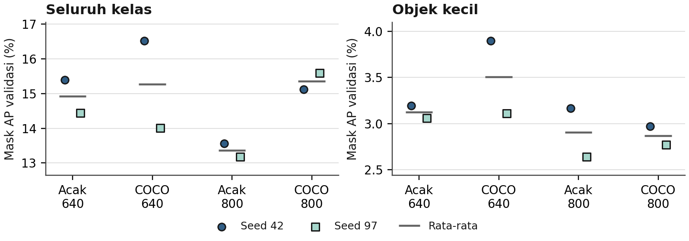

COCO 800 px memberi rata-rata AP validasi tertinggi, naik 0,44 poin terhadap acak 640 px. Selisih per seed adalah -0,27 dan +1,15 poin. AP objek kecil tertinggi muncul pada COCO 640 px. AP tiga target pada COCO 800 px turun dari 3,00% ke 1,26% di validasi. Pemilihan mengikuti aturan AP keseluruhan yang dicatat sebelum uji. [Metrik tiap run](bukti/hasil/ringkasan.json)

Dua kontrol dan enam run baru mencapai 20 epoch dengan 199 batch per epoch. Rata-rata waktu training kontrol 640 px adalah 22,25 menit dan COCO 800 px 29,20 menit. Enam run utama tugas selesai dalam kurang dari 17 menit per run. Jumlah waktu training run tambahan Mask R-CNN v2 yang dicatat mencapai 228,7 menit. Slide memberi batas dua jam per model bila akses GPU bermasalah. Anggaran per run dan akumulasi lintas konfigurasi dapat diperiksa di tabel waktu. [Waktu dan hash log per run](bukti/hasil/waktu-gpu.csv)

<!-- page-break -->

## Hasil test perbaikan dan diagnosis mask

Kedua checkpoint pada bagian ini memakai seed 97. Test publik dan foto ponsel masing-masing dinilai ulang dari prediksi tersimpan dengan anotasi dan evaluator yang sama. Selisih dihitung dari angka sebelum pembulatan.

| Metrik dan set uji | Acak 640 px | COCO 800 px | Selisih |
|---|---:|---:|---:|
| AP publik, 69 kelas | 7,01% | 7,74% | +0,74 poin |
| AP publik, tiga target NRP 8 | 1,57% | 2,29% | +0,71 poin |
| AP objek kecil publik | 2,45% | 2,72% | +0,27 poin |
| AP foto HP, 37 kelas bersama | 7,23% | 7,44% | +0,21 poin |
| AP50 foto HP, 37 kelas bersama | 14,48% | 11,64% | -2,84 poin |
| AP75 foto HP, 37 kelas bersama | 6,89% | 8,23% | +1,34 poin |
| AP objek kecil foto HP, 39 kelas | 1,45% | 3,51% | +2,06 poin |

### Di mana prediksi kehilangan objek?

Untuk setiap mask acuan publik, cari semua prediksi tersimpan pada foto yang sama. Bila tidak ada prediksi dengan IoU minimal 0,50, masukkan ke kelompok pertama. Bila ada overlap tersebut dari kelas lain saja, masukkan ke kelompok kedua. Kelompok terakhir memiliki sedikitnya satu kandidat sekelas dengan IoU minimal 0,50. Pemeriksaan ini bekerja per objek acuan. AP memakai pemeringkatan confidence dan pencocokan COCO yang memperhitungkan kompetisi antarprediksi. [Hitungan per ukuran](bukti/hasil/diagnostik-mask.csv)

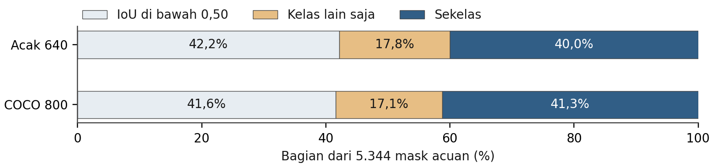

Pada kontrol, 2.254 mask (42,2%) tidak punya kandidat dengan IoU 0,50 dan 952 mask (17,8%) hanya punya kandidat dari kelas lain. Pada model COCO 800, jumlah kandidat sekelas yang melewati ambang bertambah dari 2.138 ke 2.205. Untuk 1.201 objek kecil, jumlah tersebut turun dari 169 ke 163. AP objek kecil dapat naik bersamaan dengan turunnya hitungan ini karena AP juga mengikuti urutan confidence dan ambang IoU lain. [Semua metrik test](bukti/hasil/ringkasan.json)

<!-- page-break -->

## Studi kasus kegagalan

Pada tiap foto, satu instance acuan dibandingkan dengan keluaran tiga model baseline dari evaluasi v2. Panel menampilkan prediksi sekelas jika ada irisan. Jika irisan sekelas nol, panel memakai kandidat lintas kelas dengan IoU tertinggi. Piksel dan mask acuan untuk kelima contoh cocok dengan snapshot v3. Setiap panel prediksi menyebut label keluaran dan IoU mask yang ditampilkan. [Angka IoU setiap model](bukti/hasil/kasus-iou.csv) · [Prosedur pencocokan](inspect_failures.py)

Pada panel siluet, hijau toska adalah area acuan saja, jingga adalah area prediksi saja, dan biru tua adalah irisannya. Pada panel foto, toska menandai mask acuan dan jingga menandai prediksi.

### Kasus 1. Laptop di depan kamera

Pada satu laptop besar, ketiga model memiliki IoU sekelas nol. Kandidat terdekat YOLOv8n berlabel `stairs` pada IoU 0,87. Dua kandidat lain berlabel `wall-other-merged` pada 0,81 dan `box` pada 0,85. Bentuk bidang layar sudah tertangkap. Pada Mask R-CNN, hasil ini menyempitkan diagnosis ke label keluaran karena cabang mask dapat menghasilkan kontur yang menutup layar. Penyebab pemilihan label di dalam head klasifikasi belum diukur.

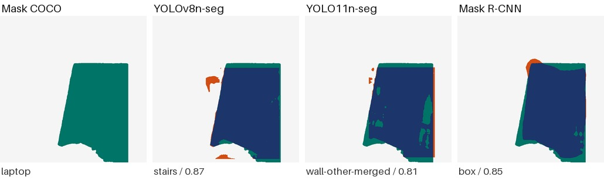

### Kasus 2. Kursi kayu berhimpitan

Mask R-CNN memberi `chair` pada IoU 0,55. IoU sekelas untuk dua YOLO mendekati nol. Kandidat lintas kelas Mask R-CNN mendapat IoU 0,77 dengan label `stairs`. Bilah kayu yang berulang dan bagian kursi yang saling menutup memberi ciri visual yang ambigu. Proposal per region pada Mask R-CNN menghasilkan satu mask kursi yang melewati IoU 0,50, sementara cabang kelas juga menghasilkan prediksi lain pada wilayah yang sama.

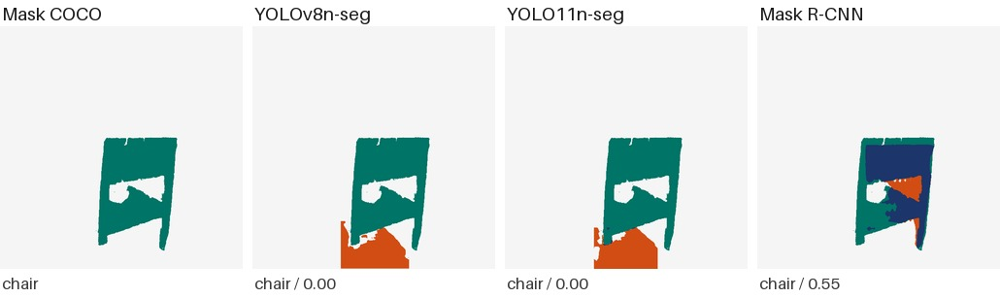

<!-- page-break -->

## Studi kasus dengan cahaya sulit

### Kasus 3. Lampu redup di plafon

Mask lampu berukuran 2.751 piksel, sekitar 0,67% kanvas. IoU sekelas nol pada ketiga model dan kandidat lintas kelas terbaik hanya 0,07. Prediksi yang bertumpang tindih berasal dari plafon atau tembok. Cabang mask per region Mask R-CNN memerlukan proposal yang cukup baik di lokasi lampu. Uji gamma memeriksa apakah pencerahan memulihkan prediksi lampu pada foto ini.

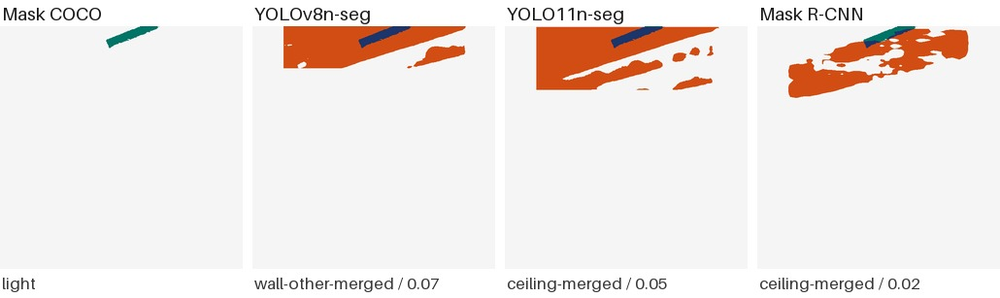

### Kasus 4. Dua orang di depan jendela

Mask `person` YOLO11n meluas ke orang kedua dan latar. IoU terhadap orang kiri 0,36. YOLOv8n dan Mask R-CNN mencapai 0,79 dan 0,76. YOLO11n membentuk mask dari peta prototipe bersama dengan koefisien khusus instance. Batas yang menyatu pada contoh ini memperlihatkan kegagalan pemisahan instance. Nilai IoU saja belum mengisolasi resolusi prototipe sebagai penyebab.

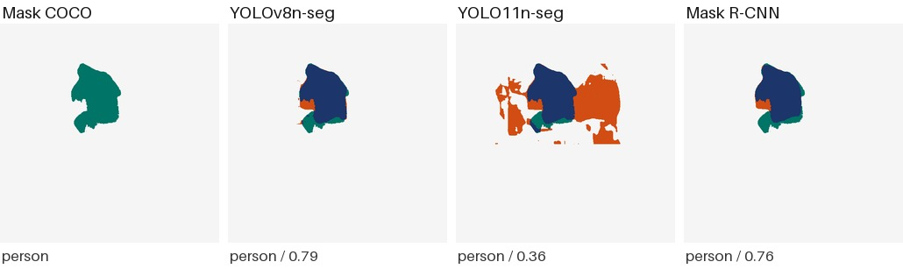

### Kasus 5. Kursi di ruang redup

YOLOv8n mengikuti kontur kursi pada IoU 0,89 dengan label `person`. YOLO11n dan Mask R-CNN memberi label `chair` pada IoU 0,90 dan 0,82. Bayangan dapat mengurangi ciri visual sandaran. Pada Mask R-CNN, perubahan cahaya bisa memengaruhi head kelas meski region dan kontur sudah mendekati acuan. Kasus ini ikut diuji memakai checkpoint Mask R-CNN v1.

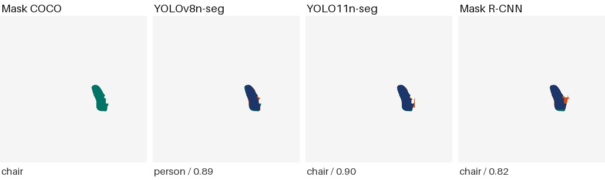

<!-- page-break -->

## Uji pencahayaan dan batas interpretasi

Empat foto redup pada snapshot v3 diuji dengan checkpoint Mask R-CNN v1 yang sama. Kontrol menggunakan piksel semula. Gamma 0,65 mencerahkan kanal warna tanpa mengubah area padding. Kategori, mask acuan, confidence minimum, dan grid evaluasi tetap sama. Seluruh pengujian kecil ini mencakup 58 mask. [Skrip uji gamma](test_low_light.py)

| Ukuran | Mask acuan | Kontrol | Gamma 0,65 |
|---|---:|---:|---:|
| Mask AP keseluruhan | 58 | 3,41% | 4,31% |
| Mask AP `person` | 6 | 8,21% | 20,62% |
| Mask AP `light` | 14 | 4,31% | 3,54% |

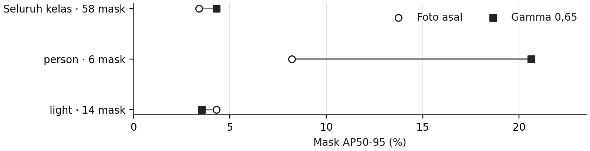

Pada lampu kasus 3, kandidat terdekat Mask R-CNN berubah dari IoU 0,024 menjadi 0,103. Label terdekat tetap `ceiling-merged` dan IoU sekelas tetap nol. Pada kursi kasus 5, IoU sekelas naik dari 0,82 ke 0,88. Kandidat terdekat berubah dari `person` menjadi `chair`. Respons terhadap pencerahan berbeda antar-instance. Uji ini memberi bukti untuk empat foto, satu checkpoint, dan satu nilai gamma. [Hasil per instance](bukti/hasil/ringkasan.json)

### Keterbatasan dan kesimpulan

Pada set foto HP, objek yang belum ditandai dapat membuat deteksi yang terlihat benar dihitung sebagai false positive. Foto berasal dari satu koleksi. Penelitian ini belum mengukur kesepakatan antaranotator atau ketidakpastian lintas ruangan. Test publik pernah diperiksa untuk diagnosis sebelum putaran perbaikan. Pemilihan varian memakai validasi, sedangkan evaluasi perbaikan pada test menguji satu seed. Hasil perbaikan bersifat eksploratif.

Mask R-CNN memimpin tiga baseline pada kedua domain. Pelatihan hanya tiga kelas melemahkan AP target pada test publik di semua pasangan. Transfer prediktor COCO dan input 800 px memperbaiki AP publik serta AP pada kelas bersama di foto HP, dengan penurunan AP50 foto HP. Pisau, lampu, dan sendok tetap mendapat AP rendah. Diagnosis overlap dan uji gamma memperlihatkan kegagalan yang berbeda antara label, batas mask, dan objek yang tidak terlacak oleh prediksi akhir.

<!-- page-break -->

## Bukti proses dan demo

| Keluaran | Letak bukti |
|---|---|
| Riwayat kode dan hipotesis | [Repositori GitHub](https://github.com/jejow/segmentasi-instance-indoor-nrp8) dan [logbook](LOGBOOK.md). |
| Waktu GPU dan log asli | [Tabel waktu per run](bukti/hasil/waktu-gpu.csv) dan [results.csv per epoch](bukti/log-training). |
| Hasil eksperimen dan visual | [CSV dan grafik](bukti/hasil), [panel mask](bukti/visual), dan [skrip pembuat lampiran](build_mask_atlas.py). |
| Foto, EXIF, dan mask | Lampiran B pada PDF lokal memuat masukan, acuan COCO, dan delapan keluaran model untuk setiap foto HP v3. Paket lokal menyertakan audit dan EXIF. Screenshot editor Roboflow masih perlu dilampirkan. [Audit data](TEST_PRIBADI.md) |
| Penggunaan AI | [Deklarasi, prompt utama, dan contoh koreksi](DEKLARASI_AI.md). |

<!-- figure: output/test-pribadi/perbaikan-mask.jpg | Bukti audit. Overlay sebelum dan sesudah pemisahan objek di Roboflow. -->

Demo memakai foto baru yang diambil saat sesi. Skrip menerima ambang confidence sebagai argumen. Mengubah ambang dari 0,15 ke 0,30 mengurangi atau mempertahankan jumlah mask dari foto yang sama. Skor per kelas bisa ditunjukkan bersama jumlah mask acuannya. [Cara menjalankan demo](README.md#demo-satu-foto) · [Skor per kelas](bukti/hasil/ap-per-kelas.csv)

### Referensi metode

He, K., Gkioxari, G., Dollár, P., dan Girshick, R. 2017. Mask R-CNN. ICCV. [Artikel](https://arxiv.org/abs/1703.06870)

Torchvision. Mask R-CNN ResNet-50 FPN v2. [Dokumentasi pembuat model dan bobot](https://docs.pytorch.org/vision/stable/models/generated/torchvision.models.detection.maskrcnn_resnet50_fpn_v2.html)

Ultralytics. Implementasi segmentasi v8.3.230. [Proses mask dan prototipe](https://github.com/ultralytics/ultralytics/blob/v8.3.230/ultralytics/utils/ops.py)

Kassis, T., Agarwal, V., He, Y., Patel, D., dan Brueckner, A. M. 2026. Scientific Agent Skills. Digunakan untuk penelusuran bukti dalam penyuntingan laporan. [arXiv:2609.00065](https://arxiv.org/abs/2609.00065)

<!-- page-break -->

## Contoh visual eksperimen NRP 8

Untuk setiap kelas target, panel mengambil instance non-crowd dengan luas mask acuan terbesar pada test v5. Baris atas memperlihatkan tiga model setelah pelatihan semua kelas. Baris bawah memperlihatkan tiga model setelah pelatihan tiga kelas, dengan mask acuan di kiri. Setiap prediksi yang ditampilkan memiliki IoU sekelas tertinggi terhadap instance tersebut. Skor adalah confidence deteksi. Kanvas tanpa overlay pada panel model berarti tidak ada prediksi sekelas yang beririsan. Ketiga contoh ini mendokumentasikan bentuk dan posisi mask pada instance terpilih. Rata-rata kinerja tetap dihitung dari seluruh test set.

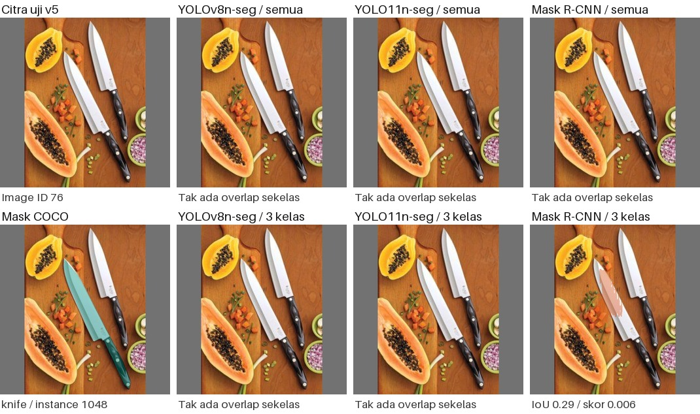

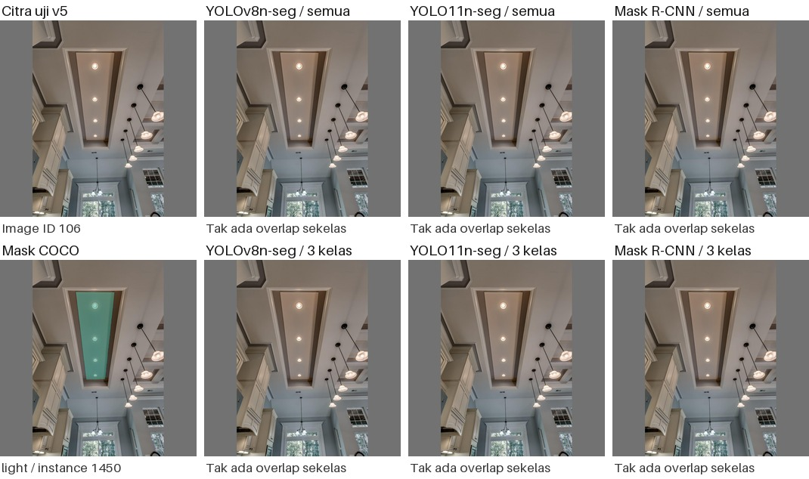

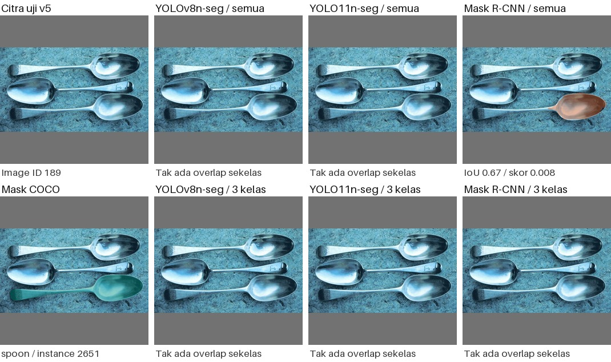

Sumber foto dan anotasi Gambar 11–13 adalah [Panoptic Indoor Segmentation v5, panopticindoor, 2024](https://universe.roboflow.com/panopticindoor/panoptic-indoor-segmentation/dataset/5), berlisensi [CC BY 4.0](https://creativecommons.org/licenses/by/4.0/). Citra dipetakan ke kanvas 640 × 640, diberi overlay mask, dan disusun menjadi panel. Setiap panel menyimpan ID citra dan instance pada ekspor yang telah diproses.

<!-- page-break -->

## Cakupan foto dan kurva training

Foto HP diurutkan seperti indeks Lampiran B. Kelas `person`, `light`, dan `chair` menyumbang 330 dari 619 mask acuan. Jumlah mask per foto berkisar antara 3 dan 51. Kondisi sulit ditetapkan lewat pemeriksaan foto sebelum analisis prediksi. [Audit foto HP](TEST_PRIBADI.md) · [Jumlah mask per foto](bukti/visual/ringkasan-overlay.json)

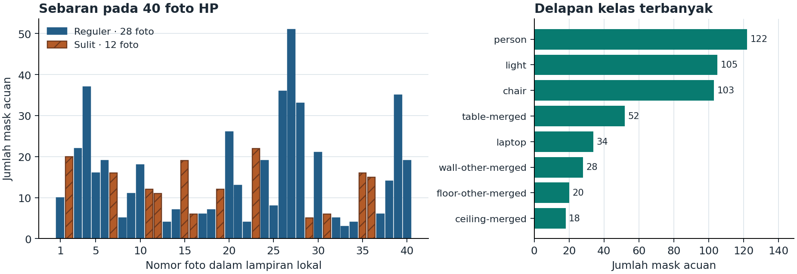

Untuk YOLO, grafik mengambil kolom Mask AP50-95 validasi dari log setiap epoch. Untuk Mask R-CNN, grafik memakai training loss dengan sumbu logaritmik. Kedua kondisi memiliki 16 epoch. [Log training asli](bukti/log-training/inti)

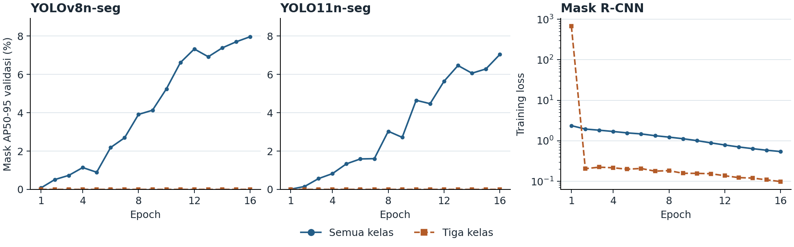

<!-- page-break -->

## Kinerja menurut ambang IoU dan kondisi foto

AP50 dan AP75 menilai mask pada IoU 0,50 dan 0,75. Panel AP50-95 mengikuti sepuluh ambang COCO. Perbandingan test resmi dan foto HP memakai 37 kelas yang beranotasi di kedua set. Pada perbandingan sesama foto HP, kelompok sulit dan reguler memakai 23 kelas bersama. [Skor tiap kelas dan model](bukti/visual/ap-kelas-lengkap.csv) · [Rangkuman evaluasi](bukti/hasil/ringkasan.json)

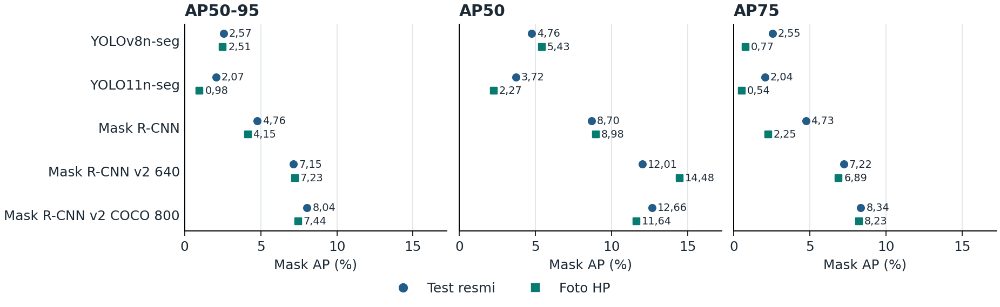

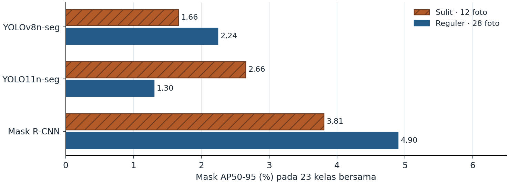

<!-- page-break -->

## Ukuran objek dan respons terhadap cahaya

AP menurut ukuran memakai pembagian luas mask COCO pada kanvas evaluasi. Kelompok kecil, sedang, dan besar dihitung pada kelas yang tersedia di masing-masing set. Untuk foto HP, hasil perbaikan pada objek kecil mencakup data dari 39 kelas yang memiliki anotasi. [Skor dan diagnosis asli](bukti/hasil/ringkasan.json)

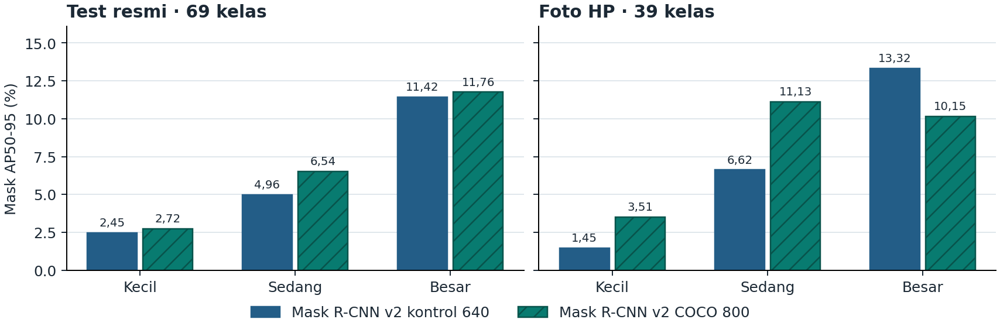

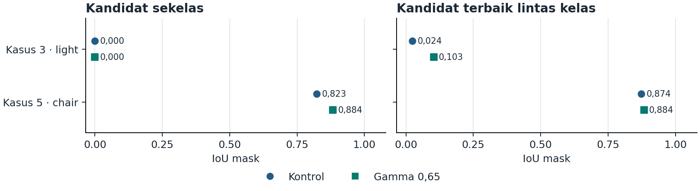

<!-- figure: output/report/visual/gamma-input.jpg | Empat masukan uji gamma. Baris pertama adalah piksel kontrol. Baris kedua memakai gamma 0,65 pada area foto dengan padding tetap. -->

<!-- page-break -->

## Kurva diagnostik dan contoh inferensi

Tiap titik pada kurva memakai satu ambang confidence dari 0,005 hingga 0,90. Prediksi dipasangkan ke paling banyak satu acuan sekelas dengan IoU mask minimal 0,50, dari skor tertinggi ke terendah. Precision dan recall dihitung secara mikro pada 37 kelas bersama dengan menjumlahkan semua pasangan. AP pada bagian hasil utama tetap memakai evaluator COCO. [Data kurva dan hitungan mask](bukti/visual/ringkasan-overlay.json)

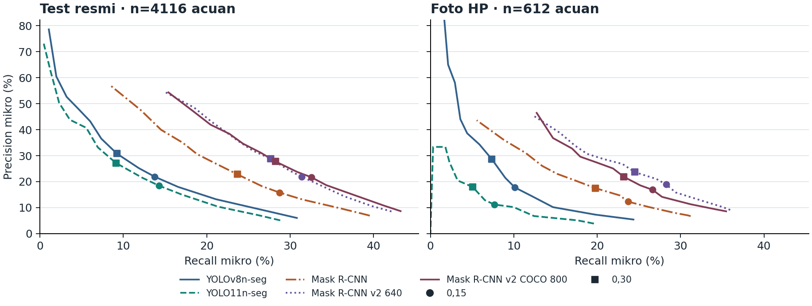

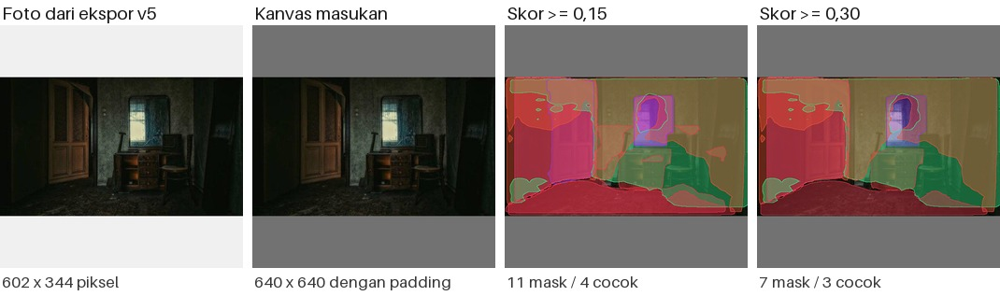

Pada citra test v5 ID 216, perubahan ambang dari 0,15 ke 0,30 menyisakan 7 dari 11 prediksi. Satu dari empat mask yang cocok dengan acuan ikut tersaring. Citra Gambar 21 berasal dari [Panoptic Indoor Segmentation v5, panopticindoor, 2024](https://universe.roboflow.com/panopticindoor/panoptic-indoor-segmentation/dataset/5), [CC BY 4.0](https://creativecommons.org/licenses/by/4.0/).

<!-- page-break -->

## AP mask per kelas

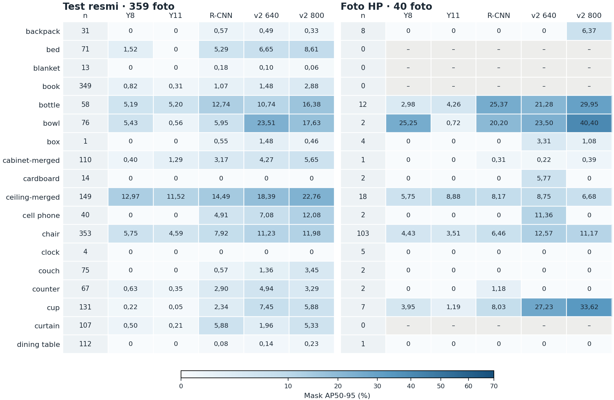

Y8 dan Y11 adalah YOLOv8n-seg dan YOLO11n-seg. R-CNN adalah Mask R-CNN baseline. v2 640 memakai prediktor acak dan input internal 640 px. v2 800 memakai transfer prediktor COCO dan input internal 800 px. Semua konfigurasi pada keempat matriks dilatih dengan seluruh kelas. Tanda pisah menunjukkan kelas tanpa mask acuan pada set uji itu. Angka 0 adalah AP nol pada kelas yang memiliki acuan. [AP50-95, AP50, AP75, dan jumlah mask dalam CSV](bukti/visual/ap-kelas-lengkap.csv)

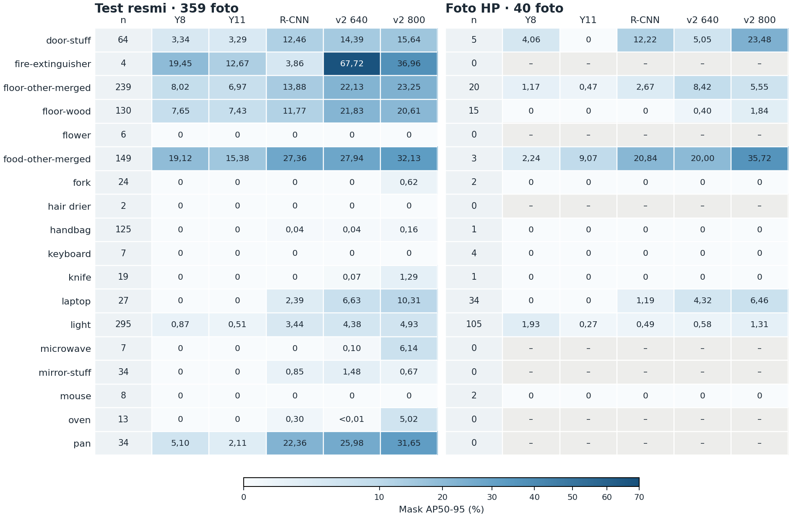

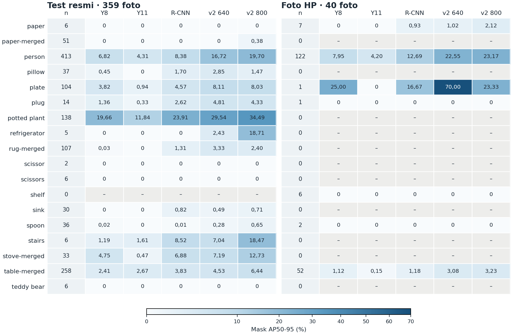

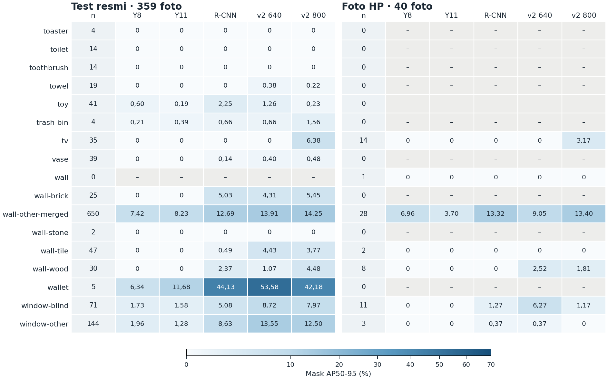

<!-- page-break -->

## Hasil NRP 8 per kelas target

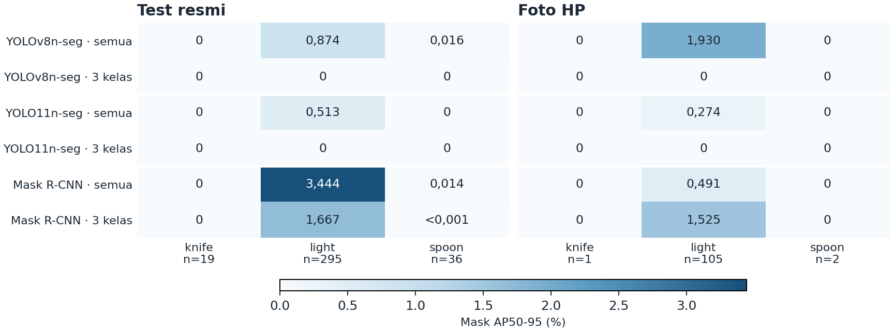

Ketiga baseline dan ketiga run tiga kelas memiliki AP pisau nol pada kedua set. Pada foto HP hanya ada satu mask pisau dan dua mask sendok, sehingga perubahan pada sedikit instance bisa mengubah kesimpulan untuk kedua kelas. [Rekap eksperimen NRP 8](bukti/hasil/nrp8-dua-test.csv) · [AP per kelas](bukti/visual/ap-kelas-lengkap.csv)

### Cara membaca lampiran mask

Setiap lembar menampilkan foto masukan dan semua mask acuan. Delapan panel prediksi memuat tiga model untuk kondisi semua kelas, tiga model untuk kondisi tiga kelas, serta Mask R-CNN v2 kontrol dan COCO 800. Panel memakai semua mask dengan confidence minimal 0,15. Daftar di sisi panel meringkas tiga prediksi berskor tertinggi atau tiga kelas acuan terbanyak. Warna kelas konsisten di seluruh panel.

Hitungan cocok mensyaratkan kelas yang sama dan IoU minimal 0,50. FP berarti prediksi tidak cocok dengan acuan. FN berarti mask acuan tidak mendapat pasangan. Pada baris tiga kelas, FN dihitung hanya untuk `knife`, `light`, dan `spoon`. Dua YOLO tiga kelas memiliki nol prediksi tersimpan pada batas evaluasi 0,005.

Lampiran A memilih empat citra v5 lewat aturan yang tetap. Citra pertama memiliki jumlah kecocokan terbesar dari tiga baseline. Citra kedua memiliki jumlah FN terbesar dari ketiganya. Dua citra lain menunjukkan kenaikan dan penurunan jumlah kecocokan terbesar saat beralih dari kontrol ke COCO 800 pada threshold tampilan. Jika nilai seri, dipilih ID terkecil. Lampiran B memuat seluruh 40 foto HP sesuai urutan indeks, termasuk 12 foto sulit. [Empat lembar test resmi](bukti/visual/atlas-v5.pdf) · [Pemilihan dan sumber prediksi](bukti/visual/ringkasan-overlay.json)
